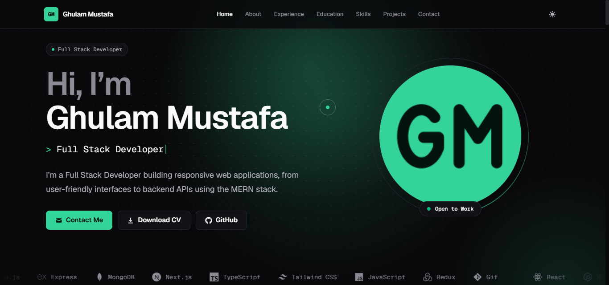
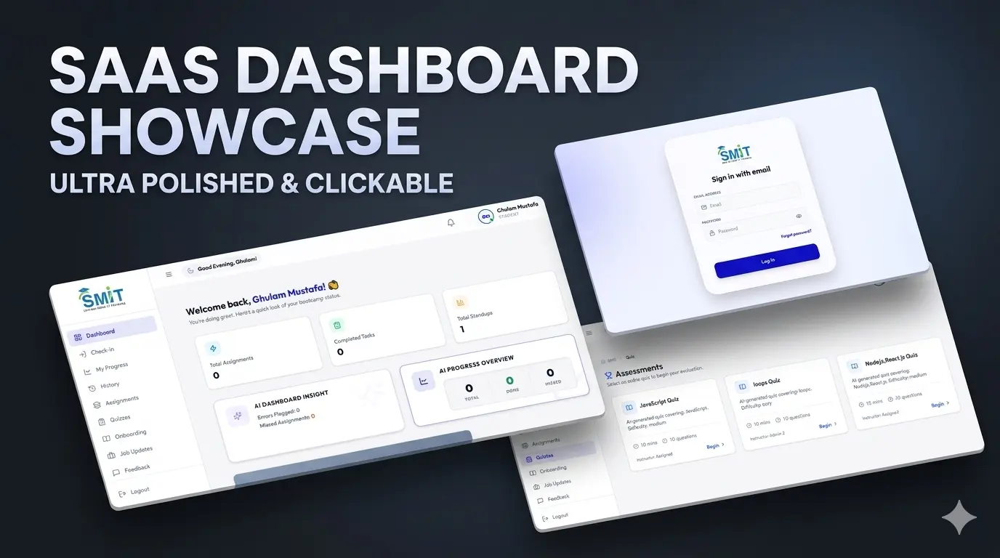
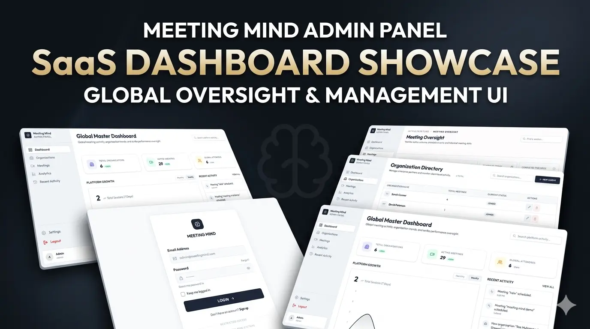
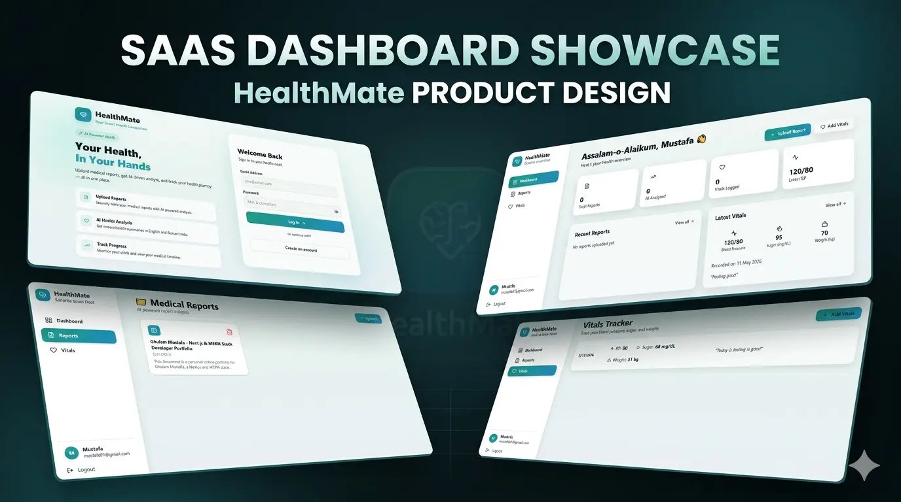
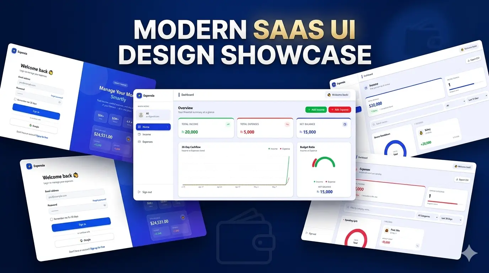
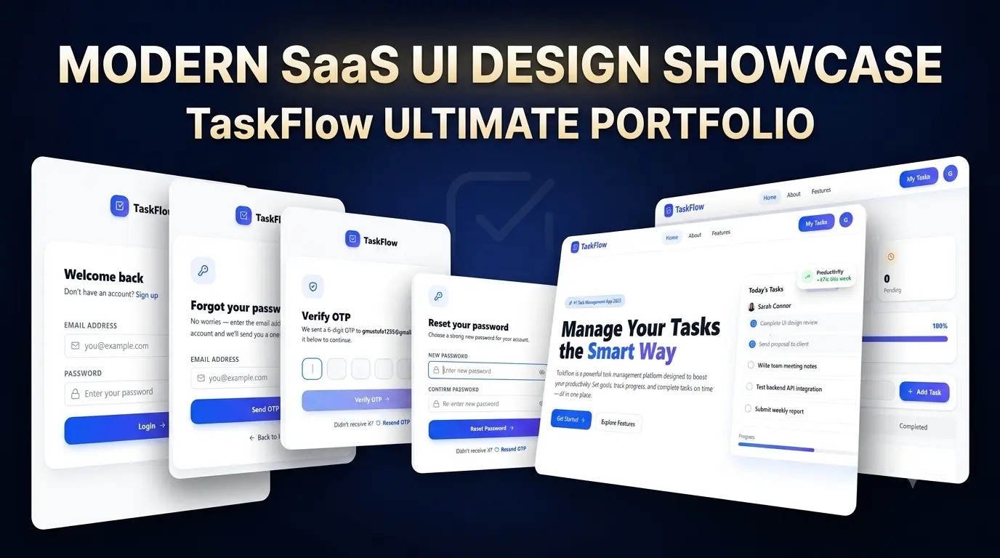
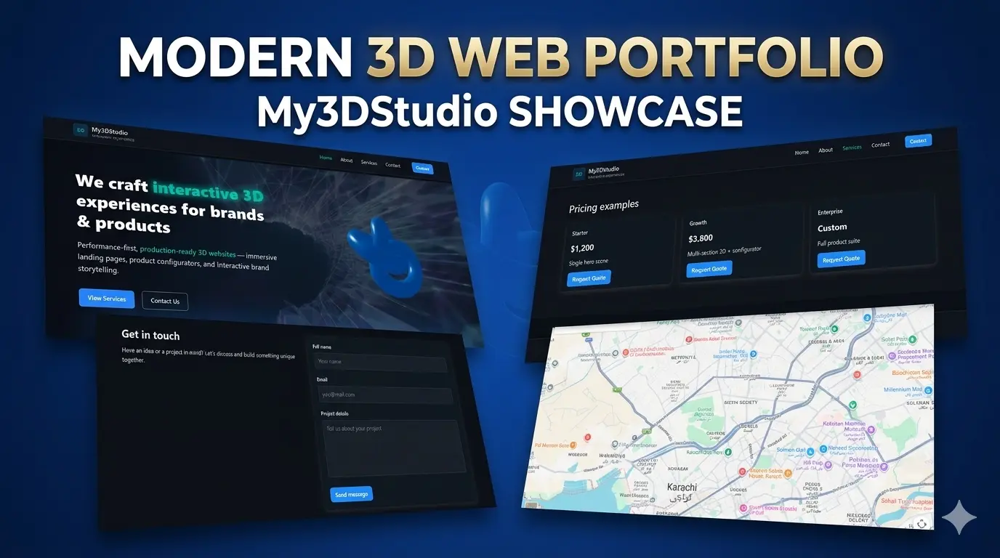

<div align="center">

# 🚀 Ghulam Mustafa — Full Stack Developer Portfolio

<p align="center">
  <strong>Modern, High-Performance, Accessible Personal Portfolio built with React 19, Tailwind CSS v4, and Framer Motion.</strong>
</p>

[](https://react.dev/)
[](https://tailwindcss.com/)
[](https://vitejs.dev/)
[](https://www.framer.com/motion/)
[](LICENSE)

<br />

<!-- Main Portfolio Preview Banner -->
<p align="center">
  
</p>

<br />

<!-- Developer Profile -->
<!--  -->

<h3>Ghulam Mustafa</h3>
<p>
  <strong>Full Stack Developer (MERN)</strong> based in Karachi, Sindh, Pakistan<br />
  ✉️ <a href="mailto:gmustufa1255@gmail.com">gmustufa1255@gmail.com</a> &nbsp;|&nbsp; 🌐 <a href="https://github.com/G-Mustafa1">GitHub</a> &nbsp;|&nbsp; 💼 <a href="https://www.linkedin.com/in/ghulam-mustufa">LinkedIn</a> &nbsp;
  <!-- |&nbsp; 📱 <a href="https://wa.me/923158965825">WhatsApp</a> -->
</p>

</div>

---

## 📌 Overview

This repository contains the source code for the personal portfolio website of **Ghulam Mustafa**, a Full Stack MERN Developer based in Karachi, Pakistan. The portfolio showcases real-world web applications, technical skills, professional background, education, and contact channels.

### ✨ Key Features

- ⚡ **Ultra-Fast Performance**: Built on top of **Vite 8** and **React 19** with esbuild bundling and zero bloat.
- 🎨 **Dual Dark Theme System**:
  - **OLED Midnight Black** (`#09090b`) for deep, true-black contrast.
  - **Charcoal Slate** (`#16181f`) with eye-friendly dark cards (`#1e212b`) — zero harsh pure white glare.
- 📱 **Fully Responsive**: Optimized for ultra-wide monitors, laptops, tablets, and mobile screens.
- 🖱️ **Interactive UX**:
  - Smooth custom cursor with interactive element snapping (desktop-only).
  - Mouse-following spotlight and ambient glow effects.
  - Marquee tech ticker and dynamic typewriter heading.
  - Reading progress indicator and smart scroll spy navbar.
- 📬 **Live Contact Form**: Client-side validation, toast notifications, honeypot spam protection, and EmailJS integration.
- ♿ **Accessibility First**: Respects `prefers-reduced-motion`, includes keyboard skip-links, ARIA landmarks, and high-contrast color ratios.

---

## 🛠️ Tech Stack

### Core Technologies
- **Frontend Framework**: [React 19](https://react.dev/)
- **Build Tool**: [Vite 8](https://vitejs.dev/)
- **Styling**: [Tailwind CSS v4](https://tailwindcss.com/)
- **Animations**: [Framer Motion 12](https://www.framer.com/motion/)
- **Icons**: [React Icons](https://react-icons.github.io/react-icons/)
- **Notifications**: [React Hot Toast](https://react-hot-toast.com/)
- **Email Service**: [@emailjs/browser](https://www.emailjs.com/)

---

## 📂 Featured Projects

Here are some of the full-stack and interactive web applications featured in this portfolio:

<br />

<table>
  <tr>
    <td width="50%" valign="top">
      
      <h3>1. Bootcamp Tracker</h3>
      <p>Built a modern MERN Stack bootcamp management platform in a team environment with student tracking, authentication, dashboard management, and responsive UI.</p>
      <p>
        <strong>Tech:</strong> React, Node.js, Express, MongoDB, JWT, Tailwind<br />
        🔗 <a href="https://bms-frontend-eight.vercel.app">Live Demo</a> &nbsp;|&nbsp; 💻 <a href="https://github.com/G-Mustafa1">GitHub</a>
      </p>
    </td>
    <td width="50%" valign="top">
      
      <h3>2. Meeting Mind</h3>
      <p>Collaborative meeting management platform with features like meeting scheduling, task organization, authentication, and responsive dashboard interfaces.</p>
      <p>
        <strong>Tech:</strong> React, Node.js, Express, MongoDB, JWT, Tailwind<br />
        🔗 <a href="https://meeting-mind-olive.vercel.app/">Live Demo</a> &nbsp;|&nbsp; 💻 <a href="https://github.com/G-Mustafa1">GitHub</a>
      </p>
    </td>
  </tr>
  <tr>
    <td width="50%" valign="top">
      
      <h3>3. Healthmate AI Integration</h3>
      <p>AI-powered healthcare platform enabling users to upload medical reports, analyze them with AI, and receive clear health insights through an intuitive UI.</p>
      <p>
        <strong>Tech:</strong> React, Node.js, Express, MongoDB, AI API, Tailwind<br />
        🔗 <a href="https://health-mate-web.vercel.app/">Live Demo</a> &nbsp;|&nbsp; 💻 <a href="https://github.com/G-Mustafa1/HealthMate-Web">GitHub</a>
      </p>
    </td>
    <td width="50%" valign="top">
      
      <h3>4. Expense Tracker</h3>
      <p>Full-stack financial management tool with income/expense logging, category breakdown, balance statistics, and real-time transaction updates.</p>
      <p>
        <strong>Tech:</strong> React, Node.js, Express, MongoDB, JWT, Tailwind<br />
        🔗 <a href="https://expence-tracker-psi-six.vercel.app/">Live Demo</a> &nbsp;|&nbsp; 💻 <a href="https://github.com/G-Mustafa1/Expence-Tracker">GitHub</a>
      </p>
    </td>
  </tr>
  <tr>
    <td width="50%" valign="top">
      
      <h3>5. MERN Auth System</h3>
      <p>Complete authentication suite with access & refresh tokens, OTP email verification, secure password reset with Nodemailer, and route protection.</p>
      <p>
        <strong>Tech:</strong> React, Node.js, Express, MongoDB, JWT, Nodemailer<br />
        🔗 <a href="https://authentication-system-khaki.vercel.app/">Live Demo</a> &nbsp;|&nbsp; 💻 <a href="https://github.com/G-Mustafa1/Authentication-System">GitHub</a>
      </p>
    </td>
    <td width="50%" valign="top">
      
      <h3>6. Interactive 3D Website</h3>
      <p>Interactive web experience using Three.js and React with smooth 3D visuals, floating objects, physics, and modern interactive aesthetics.</p>
      <p>
        <strong>Tech:</strong> React, Three.js, Framer Motion, Tailwind CSS<br />
        🔗 <a href="https://3d-web-with-react.vercel.app/">Live Demo</a> &nbsp;|&nbsp; 💻 <a href="https://github.com/G-Mustafa1/3D-Web-With-React">GitHub</a>
      </p>
    </td>
  </tr>
</table>

---

## 🗂️ Project Structure

```text
Portfolio/
├── public/
│   ├── portfolio-img.png          # Main portfolio screenshot preview banner
│   ├── bms.webp                   # Project screenshot: Bootcamp Tracker
│   ├── mm.webp                    # Project screenshot: Meeting Mind
│   ├── hl.webp                    # Project screenshot: Healthmate AI
│   ├── ex.webp                    # Project screenshot: Expense Tracker
│   ├── at.webp                    # Project screenshot: Auth System
│   ├── st.webp                    # Project screenshot: Interactive 3D
│   ├── my-image.webp              # Hero profile avatar
│   ├── Ghulam_Mustafa_CV.pdf      # Resume download asset
│   ├── favicon.svg                # Vector brand favicon
│   └── site.webmanifest           # Progressive Web App manifest
├── src/
│   ├── animations/                # Framer Motion reusable variants
│   ├── components/                # Modular UI components
│   │   ├── hero/                  # Hero avatar, tech marquee, badges
│   │   ├── contact/               # Contact form, validation, contact info
│   │   ├── Navbar.jsx             # Fixed glass navbar with scrollspy & theme toggle
│   │   ├── Footer.jsx             # Comprehensive footer with links & social icons
│   │   ├── CustomCursor.jsx       # Fine pointer custom cursor
│   │   └── SplashScreen.jsx       # Initial welcome splash animation
│   ├── context/
│   │   └── ThemeContext.jsx       # Dynamic dark/slate theme provider
│   ├── data/
│   │   ├── heroData.js            # Typewriter roles & hero constants
│   │   ├── projectData.js         # Projects list, tags, and URLs
│   │   ├── experienceData.js      # Work experience & education history
│   │   ├── sikllsData.js          # Categorized technical skills
│   │   └── contactData.js         # Contact links & metadata
│   ├── hooks/                     # Custom hooks (useScrollSpy, useTypewriter, etc.)
│   ├── layout/
│   │   └── MainLayout.jsx         # Global page wrapper with toasts & skip-link
│   ├── sections/                  # Page sections (Hero, About, Skills, Projects, etc.)
│   ├── App.jsx                    # Root component with splash screen controller
│   ├── index.css                  # Tailwind v4 theme tokens, utilities & custom styles
│   └── main.jsx                   # React 19 application entry point
├── index.html                     # Clean HTML shell with Google Fonts & SEO tags
├── package.json                   # Project dependencies and npm scripts
└── vite.config.js                 # Clean Vite 8 configuration
```

---

## 🚀 Getting Started

Follow these steps to run the portfolio locally on your machine:

### Prerequisites
- [Node.js](https://nodejs.org/) (version `18.0.0` or higher recommended)
- `npm` or `yarn` / `pnpm`

### Installation

1. **Clone the repository:**
   ```bash
   git clone https://github.com/G-Mustafa1/Portfolio.git
   cd Portfolio
   ```

2. **Install dependencies:**
   ```bash
   npm install
   ```

3. **Configure Environment Variables (Optional for EmailJS):**
   Create a `.env` file in the root directory:
   ```env
   VITE_EMAILJS_SERVICE_ID=your_service_id
   VITE_EMAILJS_TEMPLATE_ID=your_template_id
   VITE_EMAILJS_PUBLIC_KEY=your_public_key
   ```

4. **Start the local development server:**
   ```bash
   npm run dev
   ```
   Open [http://localhost:5173](http://localhost:5173) in your browser.

5. **Build for production:**
   ```bash
   npm run build
   ```

6. **Preview the production build:**
   ```bash
   npm run preview
   ```

7. **Run ESLint checks:**
   ```bash
   npm run lint
   ```

---

## 📬 Contact & Socials

If you'd like to collaborate, discuss opportunities, or have any questions:

- **Email**: [gmustufa1255@gmail.com](mailto:gmustufa1255@gmail.com)
- **LinkedIn**: [linkedin.com/in/ghulam-mustufa](https://www.linkedin.com/in/ghulam-mustufa)
- **GitHub**: [github.com/G-Mustafa1](https://github.com/G-Mustafa1)
<!-- - **WhatsApp**: [+92 315 8965825](https://wa.me/923158965825) -->

---

<div align="center">
  <sub>Designed & Developed with ❤️ by <strong>Ghulam Mustafa</strong>. All rights reserved.</sub>
</div>
